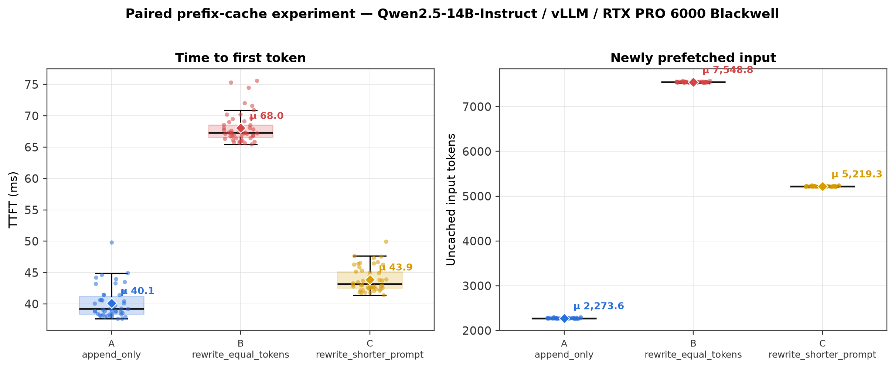
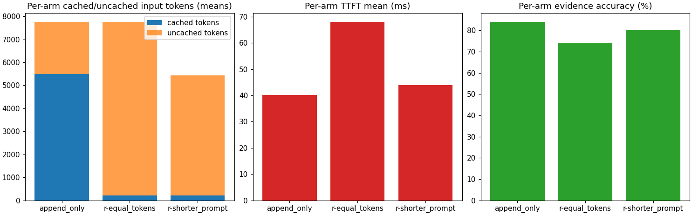
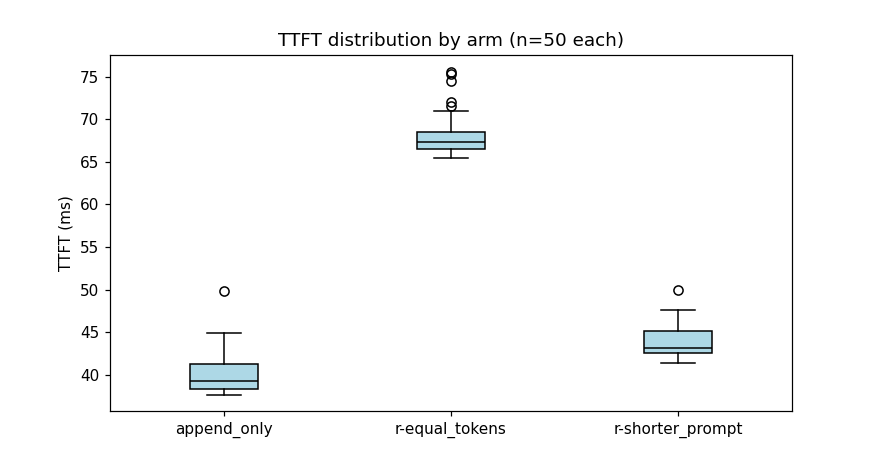
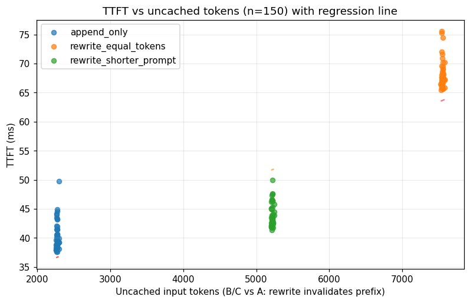
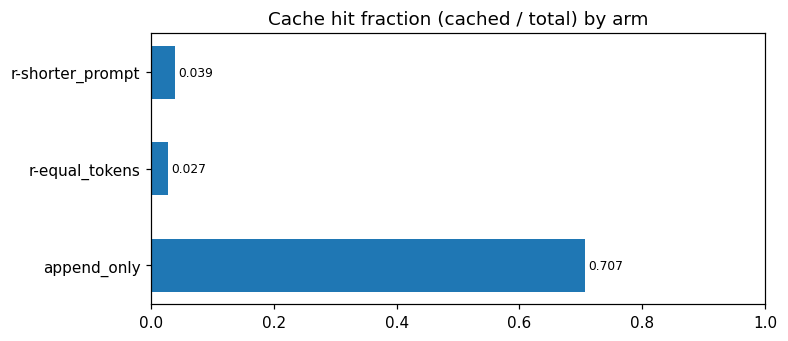
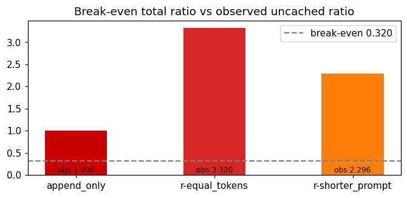
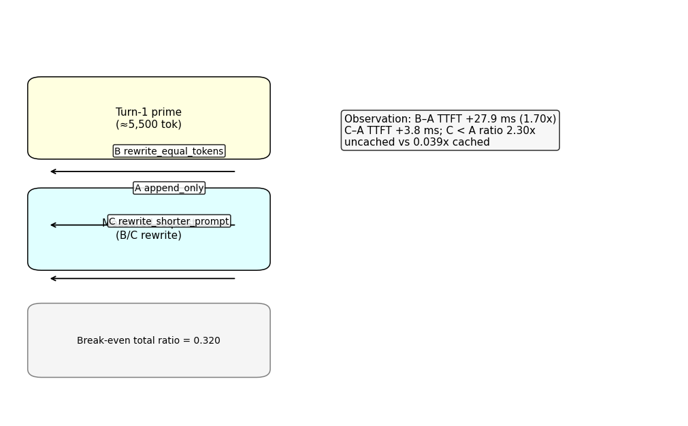

# Prefix-cache invalidation benchmark (LLM inference)

This repo contains the benchmark that measures whether, on a vLLM prefix-caching
runner, appending a tool result to an existing agent-style conversation is cheaper
than rewriting an earlier summary — even when the rewrite is shorter.

## Quick start

```bash
# Run the full benchmark (starts vLLM if needed, runs 150 measured requests, writes results/)
python benchmark_prefix_vs_rewrite.py --config run.yaml

# Analyze existing raw results
python benchmark_prefix_vs_rewrite.py --config run.yaml --analyze-only

# Execute the analysis notebook with the generated charts/diagrams
jupyter nbclient --execute --inplace prefill_cache_benchmark.ipynb
```

## Protocol

Three arms, each with 50 measured samples (10 scenarios x 5 reps), plus warmup:

- `append_only` — turn-1 context is primed, then the measured request appends a new tool result; the earlier prefix is unchanged.
- `rewrite_equal_tokens` — an early summary is rewritten; measured total tokens are equal to `append_only` within +/-2 tokens.
- `rewrite_shorter_prompt` — an early summary is rewritten shorter; measured total tokens are ~0.70x of `append_only`.

Execution details: concurrency = 1, temperature = 0.0, measured `max_tokens = 512`; turn-1 prefix target = 5,500 tokens; tool output target = 2,200 tokens; exact HF-tokenizer parity enforced.

## Key headline results

- `append_only`: cached 5488, uncached 2274, TTFT 40.12 ms
- `rewrite_equal_tokens`: cached 213, uncached 7549, TTFT 68.04 ms
- `rewrite_shorter_prompt`: cached 214, uncached 5219, TTFT 43.89 ms
- Paired deltas: B-A TTFT +27.91 ms (ratio 1.70x); C-A TTFT +3.76 ms.

## Visual results















## Interpretation

The equal-token rewrite invalidates the whole cached prefix: cache drops from 5,488 to ~213 tokens and uncached input rises to 7,549, so TTFT is +27.9 ms (≈1.7x `append_only`). The shorter rewrite also invalidates the prefix but still arrives only ~3.8 ms later than `append_only` despite being 30% shorter in total tokens (TTFT ≈1.10x). The runner-wide regression is ~5.1 ms per 1k uncached tokens. Answer accuracy stays high (84/74/80%), so the cost is timing, not correctness (at least for simpler QnA question, check report.MD for detail). A shorter rewrite becomes beneficial only if it shortens the total prompt enough to offset lost cached prefix; the run's break-even is ≈0.32 of A's total tokens (~2,487 tokens).

## Artifacts

- `artifacts/vm_results/results/summary_metrics.json` / `summary_metrics.csv`
- `artifacts/vm_results/results/raw_trials.jsonl`
- `artifacts/vm_results/results/server_telemetry.json`
- `artifacts/vm_results/results/serve_config.json`
- `artifacts/vm_results/results/vllm_server.log`
- `artifacts/vm_results/results/bench_run.log`
- `artifacts/vm_results/results/*.png` — TTFT comparison, cached/uncached scatter, boxplots, break-even vs observed, protocol diagram.

`REPORT.md` contains the full methodology and interpretation.
